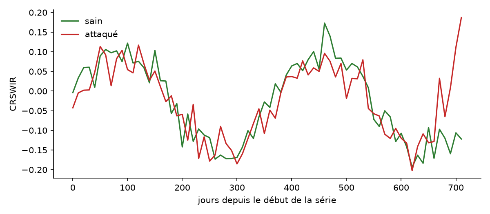

# forest-dieback-s2

Détection du dépérissement des épicéas (attaques de scolytes) à partir de séries temporelles **Sentinel-2**, sur une zone de 20 × 20 km dans les Hautes-Vosges (vallées de la Thur et de la Doller).

Le projet compare un modèle de deep learning temporel (**TempCNN**) à la méthode de référence publique **[FORDEAD](https://fordead.gitlab.io/fordead_package/latest/)** (INRAE TETIS). La comparaison se fait sur environ 200 points photo-interprétés sur orthophotos IGN, qui servent de vérité indépendante.

> 🚧 Projet en cours. Voir la [feuille de route](docs/ROADMAP.md).

| Compétence | Dans ce dépôt |
| --- | --- |
| Télédétection | Séries S2 L2A via Google Earth Engine, masque Cloud Score+, indices CRSWIR / NDVI / NDWI |
| Deep learning | TempCNN en PyTorch (puis petit Transformer temporel), découpage spatial par blocs |
| MLOps | Pipeline en scripts versionnés, `Makefile`, Docker, CI GitHub Actions, suivi MLflow |
| IA frugale | Nombre de paramètres, export ONNX, temps d'inférence CPU pour 100 km² |

## Résultats

*Les figures et le tableau seront remplis au fil des jalons.*

| Méthode | Précision | Rappel | F1 | Délai de détection (j) | Paramètres | Inférence 100 km² (CPU) |
| --- | --- | --- | --- | --- | --- | --- |
| FORDEAD (référence) | – | – | – | – | – | – |
| TempCNN | – | – | – | – | – | – |

<!--  -->
<!--  -->

## Données

Toutes les sources sont gratuites.

| Donnée | Rôle | Accès |
| --- | --- | --- |
| Sentinel-2 L2A (2017–2026) | Séries de réflectance, 10–20 m | GEE `COPERNICUS/S2_SR_HARMONIZED` |
| Cloud Score+ | Masque des nuages et des ombres | GEE `GOOGLE/CLOUD_SCORE_PLUS/V1/S2_HARMONIZED` |
| [Cartes scolytes FORDEAD](https://doi.org/10.57745/8LJGQ9) | Étiquettes faibles | Recherche Data Gouv, Etalab 2.0 |
| BD Forêt V2 (IGN) | Masque des peuplements d'épicéas | Géoservices IGN |
| BD ORTHO (IGN) | Photo-interprétation de ~200 points de contrôle | Géoservices IGN |
| Sentinel-1 GRD (option) | Radar, insensible aux nuages | GEE `COPERNICUS/S1_GRD` |

**Biais connu :** un modèle entraîné sur les cartes FORDEAD apprend d'abord à imiter FORDEAD. C'est pourquoi l'évaluation finale ne s'appuie que sur les points photo-interprétés, indépendants des deux méthodes.

## Pipeline

```
 GEE export ─► indices ─► FORDEAD (référence)
      │            │
      └────────────┴─► jeu d'entraînement (blocs spatiaux) ─► TempCNN ─► évaluation ─► ONNX + benchmark
```

| Étape | Commande | Module |
| --- | --- | --- |
| 1. Extraction S2 masquée | `make extract` | `forest_dieback.gee` |
| 2. Indices spectraux | *(à venir, avec le cube)* | `forest_dieback.indices` |
| 3. Référence FORDEAD | `make fordead` | `scripts/run_fordead.py` |
| 4. Jeu d'entraînement | *(à venir)* | `forest_dieback.dataset` |
| 5. Entraînement | `make train` | `forest_dieback.train` |
| 6. Évaluation | `make evaluate` | `forest_dieback.evaluate` |
| 7. Frugalité | `make export benchmark` | `forest_dieback.export` |

Tous les paramètres (zone, dates, bandes, hyperparamètres) sont dans [`configs/default.yaml`](configs/default.yaml).

## Installation

```bash
git clone https://github.com/frankkubler/forest-dieback-s2.git
cd forest-dieback-s2
python -m venv .venv && source .venv/bin/activate
pip install -e ".[dev]"

# Google Earth Engine
earthengine authenticate
export GEE_PROJECT=<ton-projet-gee>   # ou renseigner gee.project dans configs/default.yaml
```

Avec Docker :

```bash
docker build -t forest-dieback-s2 .
docker run --rm -v $PWD/data:/app/data forest-dieback-s2 make train
```

## Structure

```
configs/            paramètres du pipeline (zone, dates, modèle)
src/forest_dieback/ code du package (GEE, indices, dataset, modèle, entraînement, évaluation, export)
scripts/            points d'entrée en ligne de commande
tests/              tests unitaires (pytest), lancés par la CI
docs/               feuille de route et figures du README
data/               données locales, non versionnées
```

## Licence

Code sous licence MIT. Les données FORDEAD sont sous licence Etalab 2.0 et les données IGN sous licence ouverte Etalab.
